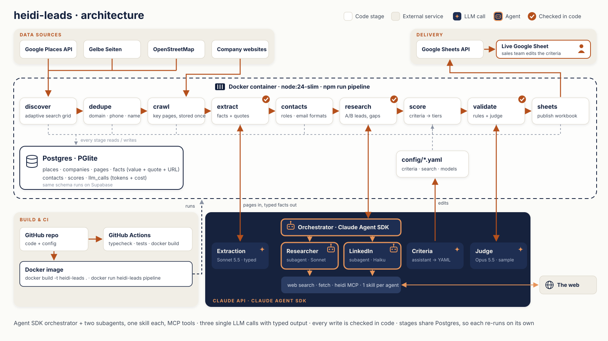

# heidi-leads

A lead pipeline I built to find **property management companies (Hausverwaltungen) in Berlin**, qualify them as customers for Heidi Systems, and identify the right person to contact at each one.

The result is a live Google Sheet: 1,189 companies, 414 confirmed property managers, 178 A/B leads with written scoring reasons, and named decision-makers with evidence-labelled emails and verified LinkedIn profiles. **Both the scoring criteria and the search (terms, sources, city) can be changed without touching code**; see [Customize and re-run](#customize-and-re-run).

```
 Google Places ─┐
 Gelbe Seiten  ─┼─> dedupe ─> crawl ─> LLM extraction ─> contacts ─> score ─> research agents ─> score ─> Google Sheet
 OpenStreetMap ─┘   (domain,  (Impressum,  (facts + verbatim   (evidence-   (YAML /   (web search,       (live formulas,
                     phone,    team, jobs,  quotes, verified    labelled     Sheet)    LinkedIn,          editable
                     name)     services)    against the page)   emails)                grounded sources)  criteria)
```

---

## Architecture

<p align="center"></p>

**Research agents run on the Claude Agent SDK** (the Claude Code agent runtime): an orchestrator delegates each top lead to two subagents, a company researcher and a LinkedIn finder. Each agent has its own skill (workflow, research playbook, LinkedIn rules), they use web search and fetch, and can only read or write lead data through an in-process MCP server that verifies every write. **Three single-call LLM components** (extraction, judge, criteria assistant) have a fixed input and a typed output. Everything else is deterministic code, and every LLM call is logged.

---

## Customize and re-run

Who counts as a good lead, and where to look for them, are business decisions, not technical ones. I made both adjustable without changing code:

| You want to… | Change | Then run | Time |
|---|---|---|---|
| Re-rank the leads (weights, size bands, tiers) | Yellow cells in the Sheet's **Criteria** tab | nothing, it updates live | instant |
| Change the criteria in words | `npm run criteria -- "..."` | runs automatically | seconds |
| Change criteria permanently | [`config/criteria.yaml`](config/criteria.yaml) | `npm run score && npm run sheets` | seconds |
| Add a new criterion | one field in the extraction schema | `npm run extract -- --force`, then score | minutes, no re-scraping |
| Search with other terms | `queries` / `directory_terms` in [`config/search.yaml`](config/search.yaml) | `npm run pipeline` | one full run |
| Run for another city | `city`, `bbox`, `postcode_range` in [`config/search.yaml`](config/search.yaml) | `npm run pipeline` | one full run |
| Use another model | [`config/models.yaml`](config/models.yaml) | the stage you changed | depends on stage |

Scoring changes are instant because scores are a pure function of stored facts. Search changes produce a new company list, so they need a full run. With Docker, the same commands run as `docker run … heidi-leads <command>`.

### A. Scoring: criteria and KPIs

#### 1. In the Google Sheet (no code)

The **Criteria** tab holds every weight, size band and tier threshold as a yellow, editable cell. Score and Tier on the Leads tab are live formulas over those cells.

- Change a weight (e.g. company size 35 → 45) and every score and tier updates instantly.
- Re-sort the Leads tab by Score to see the new ranking.
- Example: size 35 → 45 and switch trigger 20 → 10 moves A-leads from 55 to 98.

To make sure the Sheet and the code never drift apart, `npm run verify:sheet` recalculates the exported workbook with a spreadsheet engine (HyperFormula) and compares every row with the code's scores. All 1,189 rows are identical.

#### 2. In plain language

```bash
npm run criteria -- "Focus more on WEG managers"
```

An LLM edits `config/criteria.yaml`, the code validates the result (same structure, weights add up to 100), re-scores everything and prints which companies changed tier. The previous file is kept as `criteria.yaml.bak` for a one-line undo.

#### 3. In configuration

All scoring lives in [`config/criteria.yaml`](config/criteria.yaml): gates, weights, size bands and points, each with a one-line reason. Re-scoring is a pure function of stored facts, so `npm run score` takes seconds and never re-scrapes.

**Adding a new criterion** means adding one field to the extraction schema and re-running extraction on the stored pages. No website is fetched again.

### B. Search: what to look for and where

All search settings live in [`config/search.yaml`](config/search.yaml):

```yaml
city: Berlin
bbox: { south: 52.338, west: 13.088, north: 52.675, east: 13.761 }
queries:            # Google Places, run in every grid cell
  - Hausverwaltung
  - Immobilienverwaltung
  - WEG Verwaltung
  - Mietverwaltung
directory_terms:    # Gelbe Seiten categories
  - hausverwaltung
  - immobilienverwaltung
  - weg-verwaltung
postcode_range: [10115, 14199]
```

Add a search phrase, or switch the city to Hamburg with its bounding box and postcode range, and run `npm run pipeline`. Discovery is resumable and every later stage skips what's already done, so a re-run only spends on new companies. The scoring criteria stay the same across cities.

---

## The qualifying KPIs

Every KPI ties to how Heidi earns money (rent per installed device, fee per billed flat) or to how likely and how soon a manager switches provider.

| KPI | Weight | What I measure | Why it matters |
|---|---|---|---|
| Size | 35 | Units managed: stated on the site, found by research, or estimated from headcount | Revenue scales with flats and devices |
| Switch trigger | 20 | Uses a large provider (ista, Techem …), billing pain, no remote reading yet | Remote reading becomes mandatory on 1.1.2027 |
| Segment fit | 15 | WEG, rental, special-property or commercial-only management | Heating-cost billing applies to residential stock |
| Reachability | 15 | Named decision-maker, personal email, LinkedIn | Turns a company into a conversation |
| Digital readiness | 10 | Named property-management software, owner/tenant portal | Heidi integrates with the customer's ERP/CRM |
| Channel | 5 | VDIV / IVD membership | Heidi is a VDIV partner, so this is a warm introduction |

Gates exclude non-managers, commercial-only firms, municipal housing companies (tender-driven) and existing Heidi customers.

---

## Design decisions

**I used LLMs only where judgment is needed.** Discovery, crawling, deduplication, email formats and scoring are deterministic code: cheap, repeatable and unit-tested. The LLM reads unstructured German websites (extraction) and does open-ended research (agent), the two places where rules break down.

**I verify every model output in code.** Each extracted fact must come with a verbatim quote and its URL, and I check that the quote exists in the stored page; facts that fail are dropped. Research-agent claims are accepted only if their source URL appeared in that run's own search or fetch results (75 unsupported claims were rejected this way). LinkedIn profiles must be `/in/` URLs whose slug matches the person's name.

**I measured accuracy instead of assuming it.** A stronger model independently re-read 30 random companies' pages and graded each extracted fact: 236 of 240 confirmed (98%), 102 of 105 non-empty facts (97%). Rule checks run over the full dataset, and the sheet formulas are verified against the code.

**I separated fetching from thinking.** Pages are crawled once and stored. Re-extracting with a better prompt or model, adding a criterion or re-scoring never touches the websites again.

**I built the research agents on the Claude Agent SDK.**
- **Orchestrator + subagents:** three agent definitions; the `lead-orchestrator` runs the main thread and only delegates; `company-researcher` (Sonnet, web search + fetch) and `linkedin-finder` (Haiku, a cheaper model for a narrow task) each get exactly the tools they need. See [`src/agents/research/agents.ts`](src/agents/research/agents.ts).
- **MCP as the only write path:** an in-process MCP server (`heidi`) exposes `get_company`, `record_fact`, `record_person` and `finish_company`. The tools check every write in code: the cited URL must be a page the agents actually saw (tracked by `PostToolUse` hooks on WebSearch/WebFetch), LinkedIn URLs must match the person's name, and facts stated on the company's own site are never overwritten. See [`src/agents/research/tools.ts`](src/agents/research/tools.ts).
- **One skill per agent:** each agent loads its own skill from [`.claude/skills`](.claude/skills): `lead-research-orchestration` (the workflow), `hausverwaltung-research` (where to look, how to read German unit counts) and `linkedin-lookup` (search and matching rules). Prompts stay short, and the domain knowledge is versioned and reviewable.
- **Least privilege:** shell, file writes and edits are disabled; permission mode `dontAsk` denies anything not explicitly allowed.
- **Why the Agent SDK rather than hosted Managed Agents:** everything lives in this repository, so anyone can read and run it with an API key. For scheduled weekly runs in production, the same agents, tools and skill move to Managed Agents.

**I labelled every email by its evidence:**
- **published**: printed on the company website
- **company format**: built from the company's real address format, learned from a colleague's published email
- **standard format**: the standard German business format (vorname.nachname@) on a domain with a live mail server

**I chose a runtime that needs no setup.** TypeScript on Node, packaged as a Docker image. The database is embedded Postgres (PGlite), so the project runs without installing anything; the schema is plain Postgres and runs unchanged on a managed Postgres such as Supabase.

**I kept the stack minimal and add tools only when scale needs them.** LangChain and LangGraph weren't needed: the flow is a linear pipeline, and the Anthropic SDK already provides typed structured outputs (Zod) and server-side web tools. The same goes for an orchestrator like Airflow or Dagster: idempotent stages with Postgres state give the same resumability for a job of this size.

**I crawl respectfully.** A transparent user agent and low concurrency; sites with bot protection are skipped by design.

---

## In production, I would add

- **Coverage of protected sites:** a managed scraping service (e.g. Bright Data, Zyte) or a headless browser in the crawl stage.
- **Email verification:** a deliverability check (e.g. ZeroBounce, NeverBounce) on standard-format addresses before any outreach.
- **Integrations via MCP:** the same MCP pattern connects the agents to a CRM (e.g. HubSpot) or Heidi's own platform, so leads and research land where sales works.
- **Observability:** tracing for every LLM and tool call (self-hosted Langfuse or OpenTelemetry on Hetzner), with cost and accuracy dashboards; the Docker image deploys as-is to a Hetzner server.
- **Scheduling and CRM sync:** a weekly run per city on a job queue, change alerts (new companies, tier changes), and sync into the CRM.
- **Lookalike scoring:** learn weights from Heidi's existing customers instead of setting them by hand.
- **A provider signal:** the current metering provider is rarely published; tenant reviews and published utility-cost statements are the next data source.
- **An outreach agent** that drafts a first message from each lead's scoring reasons.
- **Lower cost per lead:** this version uses a strong model everywhere, tuned for accuracy first. Bulk extraction can move to Claude Haiku or a self-hosted open model at roughly 20× lower cost; the judge eval makes that switch safe, because accuracy is measured before and after.

---

## Running it

First add the keys: `cp .env.example .env` and fill in `GOOGLE_PLACES_API_KEY`, `ANTHROPIC_API_KEY`, `GOOGLE_SHEET_ID` and `GOOGLE_KEY_FILE` (the Google service-account key, shared as Editor on the Sheet).

### Option A: Docker (no local setup)

```bash
docker build -t heidi-leads .
docker run --rm --env-file .env \
  -v "$PWD/data:/app/data" -v "$PWD/output:/app/output" \
  -v "$PWD/google-keys.json:/app/google-keys.json:ro" \
  heidi-leads pipeline
```

Any stage can be run the same way, e.g. `heidi-leads score`, `heidi-leads sheets` or `heidi-leads test`. The database and results stay on the host through the two mounted folders, so container runs and local runs share the same state. CI builds the image and runs the tests in it on every push.

### Option B: Node 24

```bash
npm install
npm run pipeline              # full run, ends by publishing the Google Sheet
```

Each stage runs on its own and is idempotent: it skips work that's already done.

| Command | What it does |
|---|---|
| `npm run discover` | Google Places text search over an adaptive grid; cells that hit the 60-result cap are split into four. Resumable. |
| `npm run directories -- fetch` / `-- load` | Gelbe Seiten and OpenStreetMap as additional sources |
| `npm run companies` | Deduplicates across sources by website domain, then phone, then normalized name |
| `npm run crawl` | Fetches homepage, Impressum, about, team, services, jobs, references and contact pages; stores clean text |
| `npm run extract` | LLM extraction of typed facts with verbatim quotes, verified against the stored page |
| `npm run contacts` | Ranks people by role and builds evidence-labelled personal emails |
| `npm run research` | Agent SDK research for A/B leads: orchestrator + company-researcher + linkedin-finder subagents, writing through the verified MCP tools |
| `npm run score` | Applies `config/criteria.yaml` (seconds) |
| `npm run export` | Builds the workbook: Start here, Leads, Contacts, Criteria, Column guide, Run stats |
| `npm run sheets` | Publishes the workbook to the live Google Sheet via a service account |
| `npm run validate` | Rule checks and an independent judge model on a random sample |
| `npm run criteria -- "..."` | Changes the criteria in plain language and shows which companies moved |
| `npm run verify:sheet` | Recalculates the Sheet's formulas and compares them with the code |
| `npm test` / `npm run typecheck` | Unit tests and type checks (also run in CI) |

Every LLM call's tokens and cost are logged in the `llm_calls` table.
